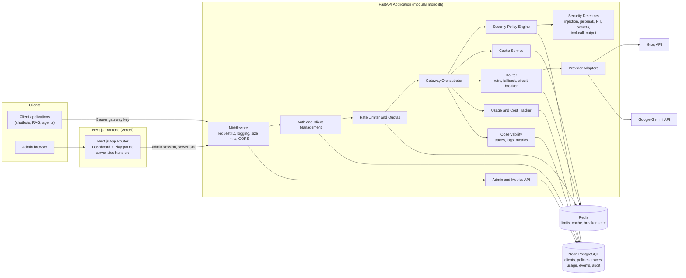
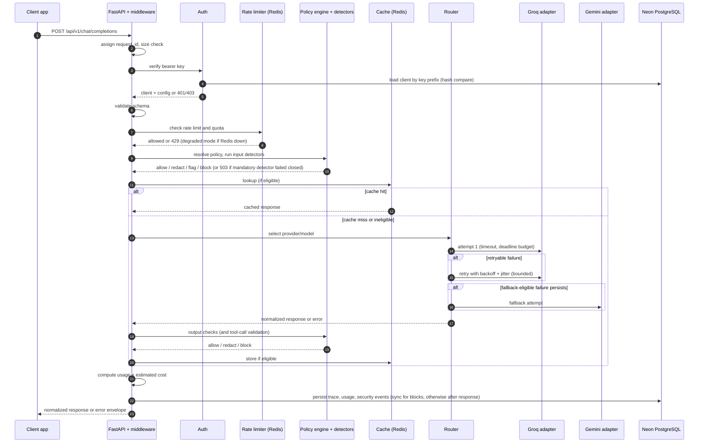
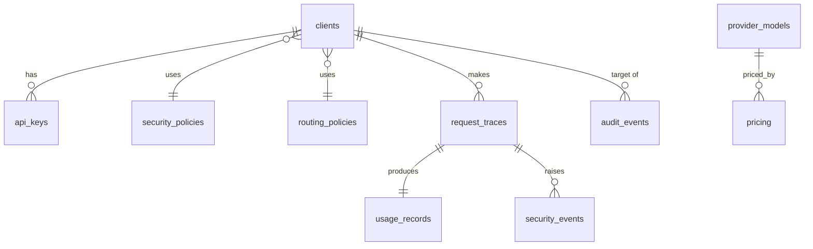

# LLMGuard — Secure LLM Gateway: Requirements Specification

**Status:** Greenfield. Nothing in this document exists yet; every file, table, endpoint and module is **proposed**.
**Audience:** A solo developer and coding agents implementing the project phase by phase.
**Constraint assumed:** Free-tier friendly (Groq and Gemini free tiers, Neon free plan, free Redis/hosting tiers). Free-tier limits change, so no limit in this document is hardcoded as fact; all are configuration.

---

## Table of Contents

1. [Project Overview](#1-project-overview)
2. [Functional Requirements](#2-functional-requirements)
3. [Required Technology Stack](#3-required-technology-stack)
4. [Dependency and Package Inventory](#4-dependency-and-package-inventory)
5. [Architecture](#5-architecture)
6. [Request Flow](#6-request-flow)
7. [Database Design](#7-database-design)
8. [API Specification](#8-api-specification)
9. [Proposed Folder Structure](#9-proposed-folder-structure)
10. [Environment Variables](#10-environment-variables)
11. [Security and Privacy Requirements](#11-security-and-privacy-requirements)
12. [Testing and Evaluation Strategy](#12-testing-and-evaluation-strategy)
13. [Non-Functional Requirements](#13-non-functional-requirements)
14. [Implementation Roadmap](#14-implementation-roadmap)
15. [Risks and Open Decisions](#15-risks-and-open-decisions)

---

## 1. Project Overview

### 1.1 Vision

LLMGuard is a **Secure LLM Gateway**: a single HTTP interface that applications call instead of calling LLM providers directly. It adds three capabilities:

| Capability | What it does |
|---|---|
| **Security** | Detects prompt injection, jailbreaks, PII and secrets; enforces per-client policies; validates tool definitions and tool calls; records security decisions. |
| **Gateway** | Routes to Groq (default primary) and Google Gemini (configurable fallback) with timeouts, bounded retries, circuit breaking, rate limits and exact-response caching. |
| **Observability** | Traces every request lifecycle step; tracks latency, errors, token usage, fallback events and **estimated** cost. |

### 1.2 Target users

Developers and small teams building chatbots, RAG apps, tool-calling agents, enterprise knowledge assistants, customer-support AI and internal automation.

### 1.3 Goals

- G1: A working, secure, measurable gateway that one developer can build, test, deploy and explain in an AI Engineer interview.
- G2: Every security and reliability claim is backed by a reproducible test or metric.
- G3: Modular monolith; clear internal interfaces so modules can be swapped (provider, detector, cache).

### 1.4 Non-goals (first release)

- Microservices, Kubernetes, message queues (Celery, Dramatiq, Kafka).
- Vector database or `pgvector` (no feature here requires similarity search).
- Semantic caching (optional P2 only).
- Executing tools on behalf of clients (the gateway **validates** tool definitions and tool calls; it never runs tools).
- Billing/payments, multi-region deployment, SSO.
- Guaranteeing that prompt injection is eliminated (it cannot be; see 11.1).

### 1.5 Priority legend

| Priority | Meaning |
|---|---|
| **P0** | Essential for the first usable release |
| **P1** | Important for a strong portfolio-quality release |
| **P2** | Optional enhancement |

### 1.6 Glossary

| Term | Definition |
|---|---|
| Gateway client | An application or developer account that calls LLMGuard with a gateway API key. |
| Admin | A privileged principal who manages clients, policies and views traces. |
| Provider | Upstream LLM vendor (Groq, Gemini). |
| Model alias | A gateway-level model name (for example `default-chat`) mapped to a provider and model ID via configuration. |
| Detector | A pluggable security check returning a structured result. |
| Policy | Versioned JSON configuration controlling detectors, thresholds, actions and fail modes. |
| Trace | Ordered lifecycle events for one request. |

### 1.7 Smallest viable first release (MVP)

All **P0** requirements: unified non-streaming endpoint, Groq + Gemini adapters, rule-based injection and PII detection with a policy engine, API-key auth, per-client rate limiting, timeouts/retries/fallback, request traces and usage/cost estimates, a minimal dashboard (overview, traces, security events, playground), and CI. Caching, streaming, quotas and advanced detectors follow.

---

## 2. Functional Requirements

**Conventions.** Every acceptance criterion (AC) must map to at least one automated test. "Deps" lists prerequisite requirement IDs. Statuses are all **Proposed**.

### 2.1 Unified LLM API (`API-*`)

| ID | Requirement | Pri | Description and expected behavior | Acceptance criteria | Deps |
|---|---|---|---|---|---|
| API-001 | Chat completions endpoint | P0 | `POST /api/v1/chat/completions` accepts a normalized request and returns a normalized response regardless of provider. | Valid request returns 200 with schema-valid body; response contains `gateway.request_id`; identical schema for Groq and Gemini (verified with mocked adapters). | PRV-001 |
| API-002 | Request validation | P0 | Pydantic v2 models validate roles, message content, parameter ranges, list lengths and unknown fields (`extra="forbid"`). | Invalid role, empty `messages`, `temperature` out of range, and unknown field each return 422 with error code `invalid_request`. | API-001 |
| API-003 | Model alias and provider selection | P0 | Client sends `model` (alias or catalog ID). Optional `gateway.provider` pins a provider. Unknown or disallowed model returns an error. | Unknown model gives 404 `model_not_found`; model outside client's allowlist gives 403 `model_not_allowed`; pinned provider disables cross-provider fallback. | PRV-003 |
| API-004 | Supported generation parameters | P0 | Supports `temperature`, `top_p`, `max_tokens`, `stop`, `seed` (if provider supports). Unsupported params are rejected or dropped per `capabilities`, never silently changed. | Param unsupported by selected provider yields either 422 `unsupported_parameter` (strict mode, default) or is dropped with a `gateway.warnings` entry (lenient mode). | PRV-002 |
| API-005 | Normalized errors | P0 | All errors use one envelope: `{ "error": { code, type, message, request_id, details } }`. No stack traces or provider secrets leak. | Every error path (401, 403, 404, 422, 429, 4xx security block, 502, 503, 504) returns the envelope; a test scans error bodies for secret patterns. | — |
| API-006 | Request and correlation IDs | P0 | Server generates `request_id` (UUIDv7 or ULID). Accepts client `X-Correlation-ID` (validated, max 128 chars, safe charset) and echoes it. IDs appear in logs, traces and responses/headers. | Every response has `X-Request-ID`; supplied correlation ID is echoed; malformed value is replaced and noted. | — |
| API-007 | Size limits and timeouts | P0 | Max body bytes, max messages, max characters per message, max `max_tokens`, overall request deadline (all configurable, with per-client overrides). | Oversized body gives 413 `request_too_large`; deadline exceeded gives 504 `gateway_timeout`; limits come from settings, not literals. | API-002 |
| API-008 | Gateway client authentication | P0 | `Authorization: Bearer <gateway key>` required on gateway endpoints. | Missing, malformed, unknown, revoked or expired key each return 401 with a distinct internal reason and a generic public message. | CLI-001 |
| API-009 | Streaming (SSE) | P2 | `stream: true` returns Server-Sent Events with normalized chunks, a final usage chunk, and a terminal `[DONE]` marker. Only enabled for providers whose adapter declares `supports_streaming`. | Chunks follow normalized schema; client disconnect cancels upstream call; blocked-mid-stream emits an `error` event then closes; non-streaming-capable provider returns 422 `streaming_not_supported`. | API-001, SEC-012 |
| API-010 | Models listing | P1 | `GET /api/v1/models` returns aliases and capabilities available to the authenticated client. | Lists only models permitted for the client; includes capability flags; never lists provider API keys or internal URLs. | PRV-003 |
| API-011 | Health endpoints | P0 | `GET /api/v1/health` (liveness, no dependency checks) and `GET /api/v1/health/ready` (checks PostgreSQL; Redis and providers reported as degraded rather than failing). | Liveness returns 200 without auth; readiness returns 503 only when PostgreSQL is unreachable; Redis outage reports `degraded`. | — |

**Public contract vs provider formats.** The public contract is gateway-defined (OpenAI-style shape for familiarity, but full OpenAI compatibility is **not** promised). Adapters translate:

| Gateway field | Groq adapter | Gemini adapter |
|---|---|---|
| `messages[role=system]` | system message | `system_instruction` |
| `messages[role=user/assistant]` | same roles | roles `user` / `model`, content mapped to `parts` |
| `max_tokens` | max completion tokens parameter | `max_output_tokens` in generation config |
| `stop` | stop sequences | `stop_sequences` |
| `tools` | tool definitions (if model supports) | function declarations |
| `usage` | provider usage block | usage metadata (field names differ) |

Exact SDK field names must be verified against SDK documentation at implementation time.

**Example request**

```json
POST /api/v1/chat/completions
Authorization: Bearer lg_dev_a1b2c3d4_<secret>
Content-Type: application/json
X-Correlation-ID: order-flow-7731

{
  "model": "default-chat",
  "messages": [
    {"role": "system", "content": "You are a concise support assistant."},
    {"role": "user", "content": "Summarize our refund policy in two sentences."}
  ],
  "temperature": 0.2,
  "max_tokens": 300,
  "stream": false,
  "gateway": {
    "provider": null,
    "allow_fallback": true,
    "cache": "default"
  },
  "metadata": {"end_user_id": "u_123", "session_id": "s_88"}
}
```

**Example response (200)**

```json
{
  "id": "req_01J9ZK3Q8V6M2N4P5R7S8T9W0X",
  "object": "chat.completion",
  "created": 1766000000,
  "model": "default-chat",
  "provider": "groq",
  "provider_model": "<catalog-provider-model-id>",
  "choices": [
    {
      "index": 0,
      "message": {"role": "assistant", "content": "Refunds are available within 30 days..."},
      "finish_reason": "stop"
    }
  ],
  "usage": {
    "prompt_tokens": 42,
    "completion_tokens": 51,
    "total_tokens": 93,
    "tokens_source": "provider",
    "estimated_cost_usd": 0.000021,
    "cost_is_estimate": true
  },
  "gateway": {
    "request_id": "req_01J9ZK3Q8V6M2N4P5R7S8T9W0X",
    "correlation_id": "order-flow-7731",
    "latency_ms": 412,
    "cache": {"status": "miss"},
    "fallback_used": false,
    "attempts": [{"provider": "groq", "outcome": "success", "latency_ms": 398}],
    "security": {
      "decision": "allow",
      "risk_score": 0.05,
      "policy_version": 3,
      "findings": []
    },
    "warnings": []
  }
}
```

**Example error (security block, 403)**

```json
{
  "error": {
    "code": "blocked_by_policy",
    "type": "security_error",
    "message": "The request was blocked by a security policy.",
    "request_id": "req_01J9ZK...",
    "details": {"categories": ["prompt_injection"], "policy_version": 3}
  }
}
```

Security details returned to clients are limited to category and policy version by default (no detector internals, to avoid giving attackers tuning feedback). Admin trace views show full findings.

### 2.2 Security and Guardrails (`SEC-*`)

**Detector contract (all detectors).**

```python
# Illustrative contract; not implementation.
class DetectorResult(BaseModel):
    detector: str                  # "prompt_injection.rules"
    category: str                  # "prompt_injection" | "jailbreak" | "pii" | "secret" | ...
    score: float                   # 0.0-1.0, calibrated per detector
    suggested_action: Literal["allow", "flag", "redact", "block"]
    reasons: list[str]             # stable reason codes, e.g. "override_instruction_phrase"
    spans: list[Span]              # character offsets for redaction; never raw matched text in logs
    error: DetectorError | None    # set on timeout/exception/invalid output
    duration_ms: float
```

Detectors are async, stateless, pure with respect to the request, and run with a per-detector timeout. Results are validated by Pydantic; invalid output is treated as a detector error.

| ID | Requirement | Pri | Description and expected behavior | Acceptance criteria | Deps |
|---|---|---|---|---|---|
| SEC-001 | Security pipeline | P0 | Ordered pipeline: validate, run input detectors concurrently, aggregate to a decision, apply actions. Same engine runs on output. | Pipeline returns a `SecurityDecision` with action, risk score, findings, policy version; detector concurrency bounded. | API-002 |
| SEC-002 | Policy model | P0 | Versioned JSON policy per client (with a global default). Defines enabled detectors, thresholds, actions, fail modes, mandatory flags, content-storage settings. Every edit increments `version`. | Policy validates against schema; invalid policy rejected with 422; version increments on change; old versions retained for traces. | DB-004 |
| SEC-003 | Decision aggregation | P0 | Precedence `block > redact > flag > allow`. A detector's score maps to action using policy thresholds. Overall `risk_score` = max detector score (documented, simple, explainable). | Table-driven tests cover every threshold boundary and precedence combination. | SEC-001 |
| SEC-004 | Prompt-injection detection (rules) | P0 | Rule/heuristic detector for instruction-override phrasing, system-prompt extraction attempts, role-reassignment, delimiter spoofing, and obfuscation (base64/hex-looking payloads, unicode confusables, zero-width characters). Returns score and reason codes. | Versioned adversarial dataset: recall and false-positive rate measured and reported (see 12.4); each reason code has at least one positive and one negative test. | SEC-001 |
| SEC-005 | Jailbreak detection | P1 | Heuristics for known jailbreak patterns (persona/"no restrictions" framing, hypothetical-wrapper framing). Optional model-based classifier is P2. | Dataset-based recall/FPR measured; detector disable-able per policy. | SEC-001 |
| SEC-006 | PII detection | P0 | Detects emails, phone numbers, payment card numbers (with Luhn validation), IBAN-like strings, IP addresses, and configurable regex entities. Locale packs (for example Indian PAN/Aadhaar with checksum validation) are P2. | Each entity type has positive, negative and boundary tests; Luhn-invalid card numbers are not flagged as cards. | SEC-001 |
| SEC-007 | PII redaction | P0 | Replaces spans with typed placeholders (`[EMAIL_1]`). Placeholders are consistent within a request. Redaction mapping is held in memory for the request only and **never persisted** by default. | Redacted text contains no original PII (test asserts); placeholder map not present in logs/traces; optional response "re-hydration" is P2. | SEC-006 |
| SEC-008 | Secret detection | P1 | Detects API-key/token/private-key patterns in prompts and outputs. Default action is block or redact per policy. | Known token formats (synthetic test fixtures only) are detected; no real credentials in the repo. | SEC-001 |
| SEC-009 | Input validation | P0 | Enforces length, encoding (valid UTF-8, normalized Unicode), control-character stripping, and role sequence rules before detectors run. | Control characters and invalid sequences are rejected or normalized per policy; normalization applied consistently to detection and cache keys. | API-002 |
| SEC-010 | Output security checks | P1 | Runs on provider output: PII leak, secret leak, system-prompt leakage heuristics (optional canary string), markdown/URL exfiltration patterns (for example images with data in query strings), and tool-call validation. | Output containing synthetic PII/secret is redacted or blocked per policy; blocked output returns 502-class `output_blocked` (or 403, see open decision OD-5) and is never cached. | SEC-001 |
| SEC-011 | Tool-call boundary validation | P1 | (a) Request `tools` are validated against client allowlist (names, count, schema size). (b) Model-emitted `tool_calls` are validated: tool name in allowlist, arguments parse as JSON, match the declared JSON Schema, and pass denylist/size/pattern checks. Gateway never executes tools. | Unknown tool name blocked; malformed JSON args blocked; schema-violating args blocked; oversize args blocked; each emits a security event. | SEC-010 |
| SEC-012 | Streaming security behavior | P2 | Input checks complete before the stream starts. Output checks operate on a bounded rolling buffer; on violation the stream is terminated with an error event. Documented limitation: tokens already sent cannot be recalled. | Mid-stream block closes stream and records event; test documents the limitation. | API-009 |
| SEC-013 | Detector failure handling | P0 | Per-detector `timeout_ms` and `on_error` (`fail_closed`/`fail_open`) plus `mandatory` flag. Mandatory detectors never silently bypass: failure under `fail_closed` returns 503 `security_check_unavailable`; under `fail_open` the request proceeds with a `detector_error` flag event and a visible warning. Default production policy: mandatory detectors fail closed. | Simulated timeout, exception and invalid output each produce the configured behavior and a recorded event; no path skips a mandatory detector silently. | SEC-001 |
| SEC-014 | Security event recording | P0 | Every block, redact, flag and detector error writes a `security_events` row with category, action, score, reason codes, detector name, policy version, request ID, direction (input/output). No raw matched content. | Event exists for each action type; no raw prompt text stored unless the client's `store_content` policy flag is explicitly enabled. | DB-007 |
| SEC-015 | Per-client policy assignment | P1 | Clients reference a policy; fall back to global default. | Client A's block threshold does not affect client B (isolation test). | SEC-002, CLI-001 |
| SEC-016 | Model-based classifier detector | P2 | Optional detector calling a small hosted model to classify injection. Must have its own timeout, cost accounting and circuit breaker, and must never receive more data than the policy allows. | Behind a feature flag; cost and latency tracked separately; failure follows SEC-013. | SEC-013, GW-006 |

**Limitations (must appear in user-facing docs).** Rule-based detection has false negatives (novel phrasing, other languages, encodings) and false positives (security discussions, quoted examples). Thresholds are tunable; metrics are reported against a versioned dataset rather than claimed in absolute terms.

### 2.3 Provider Abstraction and Routing (`PRV-*`, `GW-*`)

| ID | Requirement | Pri | Description and expected behavior | Acceptance criteria | Deps |
|---|---|---|---|---|---|
| PRV-001 | Provider interface | P0 | `ProviderAdapter` ABC: `complete()`, optional `stream()`, `capabilities()`, `health_probe()`. Adapters return `ProviderResponse` or raise typed `ProviderError`. | A fake adapter passes the same contract tests as Groq and Gemini adapters (shared contract test suite). | — |
| PRV-002 | Capability model | P0 | Per-model capabilities: max context, streaming, tools, JSON mode, supported params. | Request needing an unsupported capability is rejected or routed per policy, never silently degraded. | PRV-001 |
| PRV-003 | Model catalog and aliases | P0 | `provider_models` config maps aliases to provider + provider model ID + capabilities + enabled flag. Seeded from a versioned config file; editable via admin API (P1). | Alias resolution deterministic; disabled models excluded; catalog changes recorded in audit events. | DB-005 |
| PRV-004 | Groq adapter | P0 | Uses official Groq SDK (evaluate whether raw HTTPX is needed; default is SDK). | Mapped request/response verified with recorded fixtures; SDK exceptions mapped to normalized errors. | PRV-001 |
| PRV-005 | Gemini adapter | P0 | Uses official Google Gen AI SDK. | Same as PRV-004; system instruction and role mapping verified. | PRV-001 |
| PRV-006 | Normalized provider errors | P0 | Error taxonomy below; adapters never leak SDK exception types or raw provider bodies to clients. | Each SDK/HTTP failure fixture maps to exactly one category. | PRV-001 |
| GW-001 | Gateway orchestrator | P0 | Single service coordinating the lifecycle (6.2). Pure orchestration; business logic lives in modules. | Orchestrator unit-tested with fake auth, limiter, security, cache and providers. | all P0 modules |
| GW-002 | Routing policy | P0 | Per-client (or global) routing: primary provider/model, ordered fallbacks, `allow_fallback`, allowed models. | Routing selection is deterministic and covered by table tests. | PRV-003 |
| GW-003 | Timeouts | P0 | Per-attempt timeout and overall deadline; remaining budget shrinks across retries/fallbacks. | No sequence of attempts exceeds the overall deadline (property test with simulated latencies). | GW-001 |
| GW-004 | Bounded retries | P0 | Max retries (default 2) on retryable errors; exponential backoff with full jitter; honors `Retry-After` up to a cap; stops when deadline budget is insufficient. | Retry count never exceeds the cap; backoff delays within bounds (seeded jitter in tests); non-retryable errors never retried. | PRV-006 |
| GW-005 | Fallback | P0 | Fallback to next configured provider only for fallback-eligible errors and only if it satisfies client constraints (allowed model list, capabilities, data policy flag, security policy). | Fallback blocked when fallback model not in client allowlist or lacks required capability; response reports `fallback_used` and all attempts. | GW-002 |
| GW-006 | Circuit breaker | P1 | Per (provider, model): closed, open, half-open. Opens after N failures in a rolling window; half-open allows limited probes. State in Redis when available, else in-process. | State transitions tested with a fake clock; open circuit skips provider without calling it and records `circuit_open`. | GW-004 |
| GW-007 | Provider health metrics | P1 | Rolling success rate, error categories and latency per provider/model, exposed to admin API and dashboard. | Metrics reflect simulated failures within the configured window. | OBS-005 |
| GW-008 | Cancellation | P1 | On client disconnect, cancel in-flight provider call and stop retries; record trace status `client_cancelled`. | Test with disconnect during provider call asserts cancellation and trace status. | GW-001 |

**Provider error taxonomy and handling**

| Category | Examples | Retry same provider | Fall back | Client response |
|---|---|---|---|---|
| `provider_timeout` | Attempt timeout | Yes | Yes | 504 if exhausted |
| `provider_unavailable` | 5xx, connection reset | Yes | Yes | 502 |
| `provider_rate_limited` | 429 | Yes, honoring `Retry-After` within cap | Yes | 429 or 502 (see OD-6) |
| `provider_quota_exhausted` | Free-tier daily quota | No | Yes | 502 / 429 if no fallback |
| `provider_auth_failed` | Invalid/revoked provider key | No | Yes (alert operators) | 502 `provider_misconfigured` (details hidden) |
| `invalid_request_upstream` | 400 from provider | No | No (request problem) | 422/400 |
| `context_length_exceeded` | Prompt too long | No | Only if fallback model supports a larger context | 422 |
| `content_filtered_upstream` | Provider safety filter | No | No (do not shop for a laxer model) | 403 `provider_content_filtered` |
| `unknown_provider_error` | Unclassified | No (default) | Configurable | 502 |

"Both providers fail": return the most informative normalized error (502/504/429), list all attempts in `gateway.attempts` and the trace, never loop.

### 2.4 Authentication and Client Management (`CLI-*`)

| ID | Requirement | Pri | Description and expected behavior | Acceptance criteria | Deps |
|---|---|---|---|---|---|
| CLI-001 | Client provisioning | P0 | Admin creates clients (name, status, policy, routing, limits). Initial release may provision via admin API or CLI script. | Client created with defaults; duplicate names rejected; disabled client's keys fail with 403 `client_disabled`. | DB-001 |
| CLI-002 | API-key generation | P0 | Format `lg_<env>_<public_prefix>_<secret>`; secret from `secrets.token_urlsafe` (at least 32 bytes entropy). Key shown **once** at creation. | Key never retrievable after creation; secret has required entropy (test on length/charset). | CLI-001 |
| CLI-003 | Secure key storage | P0 | Store `prefix` (indexed lookup) and `HMAC-SHA256(secret, server_pepper)` hash. Constant-time comparison. High-entropy random keys make fast keyed hashing appropriate; slow password hashes (Argon2) are for human passwords only. | DB dump contains no plaintext key; wrong secret with correct prefix fails; comparison uses `hmac.compare_digest`; pepper loaded from env, never stored in DB. | CLI-002 |
| CLI-004 | Rotation and revocation | P0 | Revoke immediately; rotate by creating a new key with an overlap window then revoking the old one. Optional `expires_at`. | Revoked key rejected within one request (no long-lived auth cache; if caching is added, TTL ≤ documented bound and revocation invalidates it). | CLI-003 |
| CLI-005 | Admin authentication | P0 | Admin endpoints require a distinct admin credential type (separate key namespace `lga_...`, role `admin`). Client keys can never call admin endpoints. | Client key against admin endpoint returns 403; admin key against gateway endpoint is rejected unless policy allows. | CLI-003 |
| CLI-006 | Dashboard login | P1 | Dashboard authenticates admins through Next.js server-side handlers; the admin credential/session lives in an httpOnly, Secure, SameSite cookie. Browser JavaScript never sees provider keys or the raw admin key after login. | Cookie flags verified in e2e test; direct browser calls to FastAPI use session auth, not embedded secrets. | CLI-005 |
| CLI-007 | Per-client config | P1 | Per-client allowed models, limits, policy, routing, content-storage flag. | Isolation tests (client A config cannot affect client B). | SEC-015, GW-002 |
| CLI-008 | Abuse protection | P1 | Failed-auth throttling per source IP and per key prefix; request body size limits; generic auth errors. | Repeated invalid keys from one IP get 429 after threshold; error messages do not reveal whether a prefix exists. | RL-001 |
| CLI-009 | Admin audit | P1 | Admin actions (create/revoke key, edit policy, change routing) write `audit_events` synchronously. | Each admin mutation produces one audit row with actor, action, target, before/after summary (no secrets). | DB-009 |

### 2.5 Rate Limiting and Quotas (`RL-*`)

| ID | Requirement | Pri | Description and expected behavior | Acceptance criteria | Deps |
|---|---|---|---|---|---|
| RL-001 | Per-client request limit | P0 | Sliding-window (or token-bucket) limit per client and window (defaults in settings, overridable per client). Atomic via Redis Lua script. | Requests beyond limit get 429 `rate_limited` with `Retry-After`; concurrent-request test shows no over-admission. | CLI-001 |
| RL-002 | Rate-limit headers | P1 | `X-RateLimit-Limit`, `X-RateLimit-Remaining`, `X-RateLimit-Reset` (or the IETF `RateLimit` header form; choose one, see OD-7) on gateway responses. | Headers present on 200 and 429 and accurate. | RL-001 |
| RL-003 | Token/usage quotas | P1 | Optional per-client daily/monthly token and estimated-cost quotas, enforced pre-flight on `max_tokens` budget and post-hoc on actual usage. Soft overshoot (concurrent requests) is documented. | Quota exhaustion returns 429 `quota_exceeded`; reset boundary tested with fake clock. | USE-001 |
| RL-004 | Redis outage behavior | P0 | If Redis is unreachable, fall back to a stricter in-process limiter (per-instance) and record a degraded-state metric/log; policy option `fail_closed` returns 503 instead. | Simulated Redis failure never results in unlimited traffic by default; behavior configurable and tested. | RL-001 |
| RL-005 | Provider cost protection | P1 | Global ceiling on estimated daily spend and on requests/min to each provider (protect free-tier quotas). | Ceiling reached → 503/429 `capacity_protected`, recorded as event. | USE-003 |

### 2.6 Response Caching (`CACHE-*`)

Exact-match caching only in P0/P1. **Semantic caching is optional (P2)**: similar prompts can warrant different answers (different entities, dates, negation, user-specific context), so similarity alone is unsafe as a cache key.

| ID | Requirement | Pri | Description and expected behavior | Acceptance criteria | Deps |
|---|---|---|---|---|---|
| CACHE-001 | Eligibility | P1 | Cache only non-streaming, successful, output-check-passed responses with no tool calls, and when the request is deterministic (`temperature == 0` by default, or client sets `cache: "force"` if policy allows). | Ineligible requests never write cache; eligibility matrix tested. | SEC-010 |
| CACHE-002 | Key construction | P1 | `SHA256(canonical_json({client_id, policy_version, routing_version, provider, provider_model, normalized_messages, generation_params, tools_hash, cache_schema_version}))`, prefixed `llmguard:cache:v1:`. Canonicalization is deterministic (sorted keys, normalized Unicode and whitespace policy documented). | Changing any component (client, model, param, policy version, system prompt) changes the key; test per component. | SEC-009 |
| CACHE-003 | Isolation | P1 | Never share entries across clients or policy versions. | Cross-client request with identical prompt always misses. | CACHE-002 |
| CACHE-004 | TTL and invalidation | P1 | Default TTL from settings; policy/routing version bump naturally invalidates (via key); admin purge by client (P2). | Entry expires at TTL (fake clock); version bump yields miss. | CACHE-002 |
| CACHE-005 | Bypass controls | P1 | `gateway.cache`: `default`, `bypass` (skip read and write), `refresh` (skip read, write new). | Each mode tested; invalid value gives 422. | CACHE-001 |
| CACHE-006 | Sensitive data rules | P1 | Do not cache when input detectors flagged or redacted PII or secrets (default), or when client policy sets `cacheable: false`. Cached value is the post-output-check response. | Request with PII never cached by default; stored values contain no placeholder maps. | SEC-007 |
| CACHE-007 | Security on hit | P1 | Input security checks still run **before** the cache lookup. Output checks ran before storage; policy version in key forces re-evaluation after policy changes. | Policy change makes previously cached entry unreachable; blocked input never returns cached output. | CACHE-002 |
| CACHE-008 | Usage accounting for hits | P1 | Cache hit recorded with `cache_hit=true`, provider tokens = 0 billed, `estimated_cost_usd = 0`, original token counts stored as `saved_tokens` informational fields. | Usage rows for hits are distinguishable and excluded from provider-cost totals; savings metric computed. | USE-001 |
| CACHE-009 | Redis outage | P1 | Cache failures are treated as misses (never block requests) and are logged/metric'd. | Redis down: request still succeeds via provider; trace shows `cache.lookup=error`. | CACHE-001 |
| CACHE-010 | Streaming | P2 | Streaming requests bypass cache in the first release. | Streaming request never reads or writes cache. | API-009 |
| CACHE-011 | Semantic cache | P2 | Out of scope unless justified (would require vector search, embeddings, similarity thresholds and extra safety analysis). | Not implemented without a new design review. | — |

### 2.7 Usage Metering and Cost Analytics (`USE-*`)

| ID | Requirement | Pri | Description and expected behavior | Acceptance criteria | Deps |
|---|---|---|---|---|---|
| USE-001 | Usage record per request | P0 | One `usage_records` row per request outcome: client, provider, model, input/output tokens, latency, status, fallback/retry counts, cache hit, cost estimate. | Row created for success, provider failure, security block (zero provider tokens) and cache hit. | DB-008 |
| USE-002 | Token source labeling | P0 | `tokens_source`: `provider` (reported), `estimated` (heuristic, such as chars/4, clearly labeled) or `missing`. | Missing metadata yields `missing` or `estimated`, never fabricated as provider-reported. | PRV-006 |
| USE-003 | Configurable pricing | P0 | `pricing` table (provider, model, input/output price per 1M tokens, currency, `effective_from`). No hardcoded prices in code. Missing price yields `cost = null` with `cost_status="unpriced"`. | Cost computed from the pricing row effective at request time; free-tier or unknown pricing is representable (zero or null, documented). | DB-010 |
| USE-004 | Estimate labeling | P0 | All costs carry `cost_is_estimate=true` unless an exact billing import exists (not planned). | API and UI always display "estimated". | USE-003 |
| USE-005 | Failed requests | P1 | Provider failures record attempts and latency; cost 0 unless provider reports billable tokens. Fallback attempts each recorded within the trace, usage row reflects the final/billed provider(s). | Failure scenarios produce expected rows. | USE-001 |
| USE-006 | Aggregation endpoints | P1 | Usage and cost summaries by client, provider, model, time bucket. | Aggregates equal the sum of underlying rows (consistency test). | USE-001 |

### 2.8 Observability and Request Tracing (`OBS-*`)

| ID | Requirement | Pri | Description and expected behavior | Acceptance criteria | Deps |
|---|---|---|---|---|---|
| OBS-001 | Lifecycle events | P0 | Record ordered events (name, timestamp, duration, outcome, attributes) for: `request_received`, `auth`, `rate_limit`, `validation`, `security_input`, `cache_lookup`, `route_select`, `provider_attempt` (repeated), `retry`/`fallback`, `security_output`, `usage_recorded`, `response_sent`. | Trace for a normal, blocked, cached, retried and fallback request each contain the expected event sequence. | GW-001 |
| OBS-002 | Structured logs | P0 | JSON logs with `timestamp`, `level`, `request_id`, `client_id`, `event`, `provider`, `latency_ms`, `error_code`. Redaction filter strips Authorization headers, API keys and configured sensitive keys. | Log capture tests assert absence of key patterns and raw prompts; log fields present. | — |
| OBS-003 | Trace storage | P0 | `request_traces` stores summary columns plus a bounded `events` JSONB array (max events and bytes configurable). | Trace retrievable by request ID; oversize event arrays truncated with a marker. | DB-006 |
| OBS-004 | Content storage controls | P0 | Raw prompts/outputs are **not stored by default**. Store hashes, lengths, and counts. A per-client opt-in `store_content` stores redacted content with short retention. | Default trace contains no prompt text; opt-in stores only redacted text and carries an `expires_at`. | SEC-007 |
| OBS-005 | Metrics | P1 | Aggregations: request volume, success/failure rate, p50/p95/p99 latency, provider health, cache hit rate, security event counts, blocked counts. Computed from PostgreSQL (Prometheus export is P2). | Aggregate API output matches seeded dataset expectations. | USE-001 |
| OBS-006 | Error categories | P0 | Normalized `error_code` taxonomy shared by API, logs, traces and metrics. | Every error path maps to a documented code (test enumerates). | API-005 |
| OBS-007 | Retention | P1 | Configurable retention (defaults in settings): traces, security events, usage rows, stored content (shortest). A scheduled cleanup (CLI command or cron-invoked endpoint) deletes expired rows. | Cleanup deletes only expired rows (fake clock). | DB-006 |
| OBS-008 | Persistence durability modes | P0 | `AUDIT_MODE=async` (default: write after response with bounded in-memory queue and stderr dead-letter on failure) or `sync` (write before response). Security events of action `block` use sync writes regardless (decision must be durable before returning). | Queue overflow and DB failure paths log dead-letter records and do not crash requests; sync mode latency measured. | DB-006 |

### 2.9 Dashboard and API Playground (`UI-*`)

| ID | Requirement | Pri | Description and expected behavior | Acceptance criteria | Deps |
|---|---|---|---|---|---|
| UI-001 | Auth and shell | P0 | Admin login, layout, navigation, error/empty/loading states. | Unauthenticated access redirects to login; expired session handled. | CLI-006 |
| UI-002 | Overview | P0 | Request volume, success rate, latency (p50/p95), token usage, **estimated** cost, cache hit rate, over a selectable time range. | Values match API responses for seeded data. | OBS-005 |
| UI-003 | Provider health | P1 | Per provider/model success rate, error categories, latency, circuit state. | Reflects mocked provider failure data. | GW-007 |
| UI-004 | Security events | P0 | Filterable list (category, action, client, time) and blocked-request summary. | Filters work; no raw sensitive content displayed. | SEC-014 |
| UI-005 | Request traces | P0 | Search by request/correlation ID; timeline view of events, attempts, security decisions. | Trace page renders every event type; handles truncated traces. | OBS-003 |
| UI-006 | Client management | P1 | Create client, create/rotate/revoke key (key displayed once), edit limits. | Key shown once with copy control; revoke takes effect immediately. | CLI-001..004 |
| UI-007 | Policy and routing config | P1 | Form-based editors with schema validation and version display. | Invalid configs rejected client- and server-side; version increments. | SEC-002, GW-002 |
| UI-008 | API playground | P0 | Send a prompt through the real gateway pipeline using a designated **playground client** (server-side proxy); display provider, security decisions, response, latency, tokens, fallback attempts, cache status. | Playground request appears as a normal trace; provider keys never reach the browser (network-tab test). | API-001 |
| UI-009 | Demo mode | P1 | If publicly hosted: read-only or sandboxed playground, strict rate limits, no admin mutations, banner. | Demo mode blocks mutations and enforces stricter limits. | RL-001 |

---

## 3. Required Technology Stack

### 3.1 Target stack (all proposed; nothing installed yet)

| Layer | Choice | Notes |
|---|---|---|
| Language | Python 3.12+ | Use the newest supported minor compatible with all dependencies at install time. |
| API | FastAPI + Uvicorn | Async, OpenAPI generation. |
| Validation/config | Pydantic v2, pydantic-settings | Settings loaded from environment. |
| ORM/migrations | SQLAlchemy 2.x (async), Alembic | |
| DB driver | Psycopg 3 | Async engine URL form `postgresql+psycopg://`. |
| Database | Neon PostgreSQL | Pooled URL for app, direct URL for migrations (see 7.3). |
| Cache/limits | Redis (async via redis-py) | Hosted free tier (for example Upstash) or local Docker. |
| Providers | Groq SDK, Google Gen AI SDK | HTTPX only if an SDK lacks needed behavior. |
| Frontend | Next.js (App Router), React, TypeScript (strict), Tailwind CSS, shadcn/ui | |
| Charts | Recharts (shadcn chart primitives build on it) | |
| Tooling | `uv`, Ruff, pytest, pytest-asyncio, HTTPX | Static typing: Pyright or MyPy (optional, P1). |
| Dev infra | Docker + Docker Compose | Local Postgres and Redis for tests. |
| CI/CD | GitHub Actions | Lint, type-check, test, build. |
| Hosting | Vercel (frontend); Render, Railway, Fly.io or Google Cloud Run (backend) | Choose at deployment; free-tier terms change, verify. |

### 3.2 Stack decisions and rationale

| Decision | Rationale | Alternative considered |
|---|---|---|
| Modular monolith | One deployable, simpler ops, explainable. | Microservices: unjustified overhead. |
| Redis for limits/cache/breaker | Atomic ops (Lua), TTLs, shared state across instances. | In-process only: wrong when more than one instance; kept as outage fallback. |
| Custom retry and breaker (small modules) | Need deadline-aware budgeting and explicit error taxonomy; avoids extra dependency. | `tenacity`: acceptable but obscures deadline-budget logic. |
| Custom rule-based detectors first | Deterministic, fast, testable, free. | Microsoft Presidio (spaCy-heavy; evaluate later as optional PII backend), hosted classifiers (cost/latency). |
| Stdlib `hmac`/`hashlib`/`secrets` for API keys | No extra dependency; correct for high-entropy keys. | Argon2/bcrypt: wrong tool for random API keys; only for human passwords if added. |
| Request/trace persistence in PostgreSQL | One datastore for analytics at this scale. | ClickHouse/OpenTelemetry backends: P2 export only. |
| No `pgvector` | No similarity-search requirement. | — |
| No task queue | Post-response writes use FastAPI background tasks and bounded in-process queue. | Celery/Dramatiq if a durable async workload later demands it. |

---

## 4. Dependency and Package Inventory

**Version policy.** Exact versions are intentionally not specified. At implementation time, resolve the latest stable releases that are mutually compatible, record them in `uv.lock` / `package-lock.json`, and keep ranges at the **major** level given below. Re-check compatibility notes (for example Psycopg with PgBouncer, shadcn/Next.js/Tailwind versions).

### 4.1 Python — runtime

| Package | Purpose | Status | Module | Why |
|---|---|---|---|---|
| `fastapi` | REST API | Required | `api/` | Async, typed, OpenAPI. |
| `uvicorn[standard]` | ASGI server | Required | entrypoint | Standard FastAPI server. |
| `pydantic` (2.x) | Schemas | Required | all | Validation and serialization. |
| `pydantic-settings` | Config | Required | `core/config` | Typed env-based settings. |
| `sqlalchemy` (2.x, asyncio) | ORM | Required | `db/` | Async ORM, mature. |
| `alembic` | Migrations | Required | `migrations/` | SQLAlchemy-native. |
| `psycopg[binary,pool]` (3.x) | PostgreSQL driver | Required | `db/` | Async support; pooling. |
| `httpx` | HTTP client | Optional | providers (if needed), health probes | Async HTTP where an SDK is insufficient. |
| `groq` | Groq SDK | Required | `providers/groq` | Official SDK. |
| `google-genai` | Gemini SDK | Required | `providers/gemini` | Official Google Gen AI SDK. |
| `redis` (redis-py, asyncio) | Redis client | Required (rate limit/cache) | `ratelimit/`, `cache/`, `resilience/` | Async client, Lua scripting. |
| `structlog` | Structured logging | Required | `observability/` | JSON logs with context binding. (Stdlib `logging` + JSON formatter is an acceptable alternative.) |
| `uuid-utils` or `python-ulid` | Sortable IDs | Optional | `core/ids` | UUIDv7/ULID request IDs (or stdlib `uuid4` as fallback). |
| `orjson` | Fast JSON | Optional | serialization | Canonical JSON for cache keys; performance. |

Authentication/key hashing uses the **standard library** (`hmac`, `hashlib`, `secrets`); no extra package. `argon2-cffi` is optional, only if human-password admin login is added (CLI-006 variant).

### 4.2 Python — development and test

| Package | Purpose | Status | Module |
|---|---|---|---|
| `pytest`, `pytest-asyncio` | Test runner, async tests | Required | tests |
| `httpx` (ASGI transport) | API tests | Required | tests |
| `pytest-cov` | Coverage | Required | CI |
| `ruff` | Lint and format | Required | CI |
| `pyright` or `mypy` | Static typing | Optional (P1) | CI |
| `fakeredis` | Redis unit tests | Optional | tests |
| `respx` | Mock HTTPX calls | Optional | provider tests |
| `freezegun` or `time-machine` | Time control | Optional | cache/limit tests |
| `hypothesis` | Property tests (retry budgets, canonicalization) | Optional | tests |
| `locust` | Load testing | Optional (P1) | `tests/load` |

### 4.3 Frontend

| Package | Purpose | Status | Why |
|---|---|---|---|
| `next` (App Router), `react`, `react-dom` | App framework | Required | Chosen stack. |
| `typescript` (strict) | Types | Required | Type safety. |
| `tailwindcss` | Styling | Required | |
| shadcn/ui (copies components) + `class-variance-authority`, `clsx`, `tailwind-merge`, `lucide-react`, Radix primitives as pulled in by components | UI components | Required | Consistent accessible components. |
| `recharts` | Charts | Required | Time series and bars; works with shadcn charts. |
| `zod` | Form/response validation | Required | Client-side validation, parse API responses. |
| `react-hook-form` + `@hookform/resolvers` | Forms | Optional | Policy/client forms. |
| `@tanstack/react-query` | Client data fetching | Optional | Polling dashboards; server components may suffice. |
| `openapi-typescript` (dev) | Generate types from FastAPI OpenAPI | Recommended | Typed contracts without hand-copying. |
| `vitest`, `@testing-library/react` | Unit/component tests | Required (dev) | |
| `@playwright/test` | E2E | Optional (P1) | |
| `eslint`, `prettier` | Lint/format | Required (dev) | |

---

## 5. Architecture

### 5.1 High-level diagram



### 5.2 Component responsibilities and boundaries

| Component | Responsibility | Must not |
|---|---|---|
| Middleware | Request ID, correlation ID, body-size limit, structured request logging, CORS, exception to error-envelope mapping. | Contain business logic. |
| Auth and client mgmt | Verify gateway/admin keys, load client config, manage keys. | Hold provider credentials. |
| Rate limiter | Per-client windows, quotas, auth-failure throttling; degraded mode. | Call providers. |
| Orchestrator | Run the lifecycle in order; assemble the response; record trace events. | Implement detectors or provider logic. |
| Policy engine | Resolve client policy, run detectors with timeouts, aggregate decision, apply redaction. | Persist directly (emits events to observability). |
| Detectors | Pure analysis returning `DetectorResult`. | Perform network calls (except optional P2 classifier, behind a flag). |
| Cache service | Eligibility, key construction, get/set with TTL, isolation. | Skip security checks. |
| Router | Select provider/model, retries, backoff, fallback, circuit breaker, deadline budget. | Mutate request semantics. |
| Provider adapters | Translate to/from SDK calls; map errors; declare capabilities. | Leak SDK types or secrets. |
| Usage tracker | Compute token/cost estimates from pricing config; produce usage rows. | Hardcode prices. |
| Observability | Trace events, structured logs, redaction, persistence queue, metrics queries. | Log secrets or raw prompts. |
| Admin/metrics API | CRUD for clients, keys, policies, routing; read APIs for traces/events/usage. | Be reachable with client keys. |
| Next.js frontend | UI, server-side proxy for playground/admin calls. | Access Neon, Redis, or provider keys; expose admin key to browser JS. |

### 5.3 Trust boundaries and sensitive components

| Boundary | Threats | Controls |
|---|---|---|
| Internet to FastAPI | Credential stuffing, oversized payloads, injection payloads | TLS, auth throttling, size limits, validation, rate limits |
| Client prompt content (untrusted) to detectors/LLM | Prompt injection, PII, secrets | Detector pipeline, policy, least-privilege tools (client side) |
| FastAPI to providers | Key leakage, SSRF-like misuse, data exposure | Keys in env/secret store only, fixed provider hosts, redacted logs, PII redaction per policy |
| LLM output (untrusted) to client/tools | Leakage, exfiltration, malicious tool calls | Output checks, tool-call validation |
| FastAPI to Neon/Redis | Credential compromise, data exposure | TLS connections, least-privilege DB role, no secrets in DB, retention limits |
| Browser to Next.js | XSS, CSRF, session theft | httpOnly Secure SameSite cookies, CSRF protection for mutations, CSP, escaped rendering of trace data |

**Security-sensitive components:** key verification, policy engine, detectors, redaction, cache key construction, log redaction filter, admin API, Next.js server proxy.

### 5.4 Key design decisions

| # | Decision | Trade-off |
|---|---|---|
| D1 | Detectors run concurrently with per-detector timeouts | Lower latency; need bounded concurrency and deterministic aggregation |
| D2 | Input checks precede cache lookup | Slight latency cost; prevents cache from bypassing policy |
| D3 | Audit writes async by default, sync for blocks | Lower p95 latency vs. possible loss of non-critical traces on crash |
| D4 | Policy/routing versions embedded in cache keys | Natural invalidation; lower hit rate after config edits |
| D5 | Gateway never executes tools | Smaller attack surface; clients own execution and authorization |
| D6 | Estimates, not billing truth | Honest labeling; may deviate from provider invoices |

---

## 6. Request Flow

### 6.1 Sequence diagram



### 6.2 Numbered lifecycle

1. Client sends the request; middleware assigns `request_id`, validates `X-Correlation-ID`, enforces body-size limit. *(sync)*
2. **Authentication/authorization**: parse bearer key, look up by prefix, compare HMAC in constant time, check status, expiry, client enabled. *(sync)*
3. **Validation**: Pydantic schema, size and parameter limits, Unicode normalization. *(sync)*
4. **Rate limits and quotas**: atomic Redis check; consume. *(sync)*
5. **Policy resolution**: load client policy (in-process cache with short TTL and version check). *(sync)*
6. **Input security**: detectors run concurrently with timeouts; decision aggregated; redaction applied to the text sent onward; block returns immediately. *(sync)*
7. **Cache lookup** if eligible. A hit skips steps 8 to 10. *(sync)*
8. **Routing**: resolve alias, check client allowlist and capabilities, build attempt plan. *(sync)*
9. **Provider call** via adapter. *(sync, awaited)*
10. **Timeouts/retries/fallback** within the overall deadline budget; circuit breaker consulted per attempt. *(sync)*
11. **Output security**: output detectors, tool-call validation, redaction or block. *(sync)*
12. **Cache store** (if eligible; failure ignored). *(sync, best effort)*
13. **Usage and cost** computed from provider usage metadata or labeled estimate. *(sync computation)*
14. **Persistence**: trace, usage, security events. Blocks and admin audits are written before responding; other records are queued and written after the response (`AUDIT_MODE`). *(mixed)*
15. Return the normalized response or error envelope with headers (`X-Request-ID`, rate-limit headers).

**Atomicity note.** There is no atomic transaction across PostgreSQL, Redis and external providers. A request can succeed upstream while persistence fails (usage lost) or a cache write can fail after success. The design makes each of these an **observable, non-fatal** condition (dead-letter logs, metrics), and chooses idempotent writes keyed by `request_id` (unique constraints) so retried persistence does not duplicate rows. Provider calls are not idempotent; a client retry may be billed twice. Optional client-supplied `Idempotency-Key` is P2.

### 6.3 Failure behavior matrix

| Scenario | Behavior |
|---|---|
| **Redis unavailable** | Rate limiting: stricter in-process limiter (or 503 if `RATE_LIMIT_FAIL_MODE=closed`). Cache: treated as miss, never blocks. Circuit breaker: in-process state. All emit degraded-mode logs/metrics; readiness reports `degraded`. |
| **PostgreSQL unavailable** | Auth requires DB (or a short-TTL in-process client cache, if implemented; revocation lag documented): default is 503 `service_unavailable` for gateway requests. Trace/usage persistence failures after the response go to stderr dead-letter logs; they never change the response of an already-completed request. Readiness returns 503. |
| **Detector timeout/exception/invalid output** | Per SEC-013: mandatory + fail-closed gives 503 `security_check_unavailable`; fail-open continues with `detector_error` event and `gateway.warnings`. Non-mandatory detectors record the error and continue. |
| **Primary provider fails** | Retry if retryable (bounded), then fallback if eligible and constraint-compatible; attempts reported. |
| **Both providers fail** | Return normalized 502/504/429 with all attempts in the trace; no further retries. |
| **Client cancels** | Detect disconnect, cancel provider call, stop retries/fallback, trace `client_cancelled`, usage recorded with `status=cancelled` and tokens `missing` unless provider reported. Provider may still bill for work already done (documented). |
| **Streaming enabled (P2)** | Input checks and routing as usual; fallback only **before first token** is sent; after the first chunk, failures end the stream with an error event; output checks use a rolling buffer; usage recorded at end (or estimated). |
| **Provider usage metadata missing** | `tokens_source="estimated"` using documented heuristic, or `missing` if estimation disabled; cost labeled estimate or null. |
| **Both Redis and PostgreSQL down** | 503; readiness fails. |

### 6.4 Latency versus audit durability

| Mode | Behavior | Trade-off |
|---|---|---|
| `async` (default) | Persist after response through bounded queue | Lowest latency; traces may be lost on crash or overflow (dead-letter logged) |
| `sync` | Persist before response | Durable audit; adds DB round-trip (Neon latency) to every request |
| Blocks (always sync) | Security block events are written before returning | Guarantees a record of denied requests |

---

## 7. Database Design

### 7.1 Model inventory and justification

| Table | Needed? | Justification |
|---|---|---|
| `clients` | Yes | Tenant identity, status, limits, policy/routing references |
| `api_keys` | Yes | Separate rotation/revocation lifecycle; multiple keys per client |
| `security_policies` | Yes | Versioned policy documents |
| `routing_policies` | Yes | Versioned routing config; separable from security |
| `provider_models` | Yes | Alias catalog and capabilities; editable without deploys |
| `pricing` | Yes | Configurable, time-effective prices |
| `request_traces` | Yes | Per-request lifecycle and summary |
| `usage_records` | Yes | Narrow, aggregation-friendly rows retained longer than traces; kept separate from the wide JSONB trace to keep analytics queries fast |
| `security_events` | Yes | Independently queried/retained; one request can have many events |
| `audit_events` | Yes | Admin action history, long retention |
| Prompt/response content tables | **No** | Content not stored by default; opt-in redacted preview lives as a nullable, expiring column on `request_traces` |
| Vector tables | **No** | No similarity-search requirement |

Providers themselves are not a table: credentials are env-based and adapters are code. `provider_models` holds model-level config.

### 7.2 ER overview



### 7.3 Table specifications

Common conventions: primary keys are UUIDs (or ULIDs); timestamps are `timestamptz` UTC; `created_at`/`updated_at` on mutable tables; JSONB for flexible config validated by Pydantic before write.

**`clients`**

| Field | Type | Notes |
|---|---|---|
| id | uuid PK | |
| name | text unique | |
| status | enum (`active`,`disabled`) | |
| security_policy_id | fk | nullable, falls back to default |
| routing_policy_id | fk | nullable |
| rate_limit_rpm / window_seconds | int | overrides of defaults |
| daily_token_quota / monthly_cost_quota | bigint / numeric | nullable |
| allowed_models | text[] | allowlist of aliases |
| store_content | bool | default false |
| created_at, updated_at | timestamptz | |

Indexes: unique(name), index(status). Sensitive: none beyond identity. Retention: indefinite until deleted.

**`api_keys`**

| Field | Type | Notes |
|---|---|---|
| id | uuid PK | |
| client_id | fk | cascade restrictions via soft-disable |
| prefix | text unique | public lookup identifier |
| key_hash | bytea | HMAC-SHA256 output, never plaintext |
| role | enum (`client`,`admin`) | |
| status | enum (`active`,`revoked`) | |
| expires_at, last_used_at, revoked_at | timestamptz | `last_used_at` updated at most every N minutes to limit write load |
| label | text | |

Indexes: unique(prefix), index(client_id, status). Sensitive: hash only. Retention: keep revoked rows for audit.

**`security_policies`** / **`routing_policies`**

| Field | Type | Notes |
|---|---|---|
| id | uuid PK | |
| name | text | |
| version | int | increments per edit; (name, version) unique |
| config | jsonb | validated policy document |
| is_default | bool | |
| created_by | text | admin identity |
| created_at | timestamptz | |

Version history retained (new row per version) so traces can reference exact `policy_version`.

**`provider_models`**

| Field | Type | Notes |
|---|---|---|
| id | uuid PK | |
| alias | text unique | for example `default-chat` |
| provider | enum (`groq`,`gemini`) | |
| provider_model_id | text | verified against provider docs at seed time |
| capabilities | jsonb | context window, streaming, tools, JSON mode, params |
| enabled | bool | |

**`pricing`**

| Field | Type | Notes |
|---|---|---|
| id | uuid PK | |
| provider, provider_model_id | text | |
| input_price_per_mtok / output_price_per_mtok | numeric | nullable (unknown) |
| currency | char(3) | default USD |
| effective_from | timestamptz | lookup picks latest effective_from at or before request time |
| source_note | text | where the figure came from (informational) |

**`request_traces`**

| Field | Type | Notes |
|---|---|---|
| request_id | text PK | unique, idempotency key for persistence |
| correlation_id | text | indexed |
| client_id | fk | indexed |
| started_at | timestamptz | indexed (time-range queries) |
| status | enum | `success`, `blocked`, `error`, `client_cancelled`, `cache_hit` |
| http_status | int | |
| error_code | text | |
| provider, provider_model | text | final provider |
| fallback_used, retry_count | bool/int | |
| latency_ms | int | |
| security_decision, risk_score, policy_version | | |
| cache_status | enum | `hit`, `miss`, `bypass`, `ineligible`, `error` |
| prompt_hash | text | SHA-256 of normalized input (for correlation, not reversible content) |
| input_chars, output_chars | int | |
| events | jsonb | bounded event timeline |
| content_preview | jsonb nullable | redacted, only if `store_content`; `content_expires_at` set |
| created_at | timestamptz | |

Indexes: (client_id, started_at desc), (status, started_at), (correlation_id), BRIN or btree on started_at. Retention: default short (configurable, for example 30 days); content preview shortest (for example 7 days).

**`usage_records`**

| Field | Type | Notes |
|---|---|---|
| request_id | text PK/FK | one row per request |
| client_id, provider, provider_model | | |
| input_tokens, output_tokens | int nullable | |
| tokens_source | enum | `provider`,`estimated`,`missing` |
| estimated_cost | numeric nullable | |
| cost_status | enum | `estimated`,`unpriced`,`zero_cached` |
| cache_hit | bool | |
| saved_tokens | int nullable | informational for hits |
| latency_ms | int | |
| status | enum | |
| created_at | timestamptz | |

Indexes: (client_id, created_at), (provider, provider_model, created_at). Retention: longer than traces (for example 12 months, configurable).

**`security_events`**

| Field | Type | Notes |
|---|---|---|
| id | uuid PK | |
| request_id | fk (nullable for pre-request events such as auth floods) | |
| client_id | fk nullable | |
| direction | enum (`input`,`output`,`tool_call`) | |
| category | text | |
| action | enum (`block`,`redact`,`flag`,`detector_error`) | |
| detector | text | |
| score | real | |
| reason_codes | text[] | |
| policy_version | int | |
| created_at | timestamptz | |

Indexes: (created_at desc), (client_id, created_at), (category, action, created_at). **No raw matched text.**

**`audit_events`**

| Field | Type | Notes |
|---|---|---|
| id | uuid PK | |
| actor | text | admin identity/key prefix |
| action | text | |
| target_type, target_id | text | |
| summary | jsonb | before/after diff **without secrets** |
| created_at | timestamptz | |

Retention: long (for example 12+ months). Written synchronously.

### 7.4 SQLAlchemy, Alembic and Neon working together

- **SQLAlchemy 2.x** declarative models in `app/db/models/`; async sessions via `async_sessionmaker`; a repository layer wraps queries (no ORM calls in routes).
- **Alembic** owns the schema. Autogenerate migrations, **review them manually**, commit them; CI runs `alembic upgrade head` against a clean Postgres and checks for drift (`alembic check`).
- **Neon connections** (verify against current Neon documentation at implementation time):
  - Application uses the **pooled** connection string (host containing `-pooler`), which sits behind PgBouncer in transaction mode. With Psycopg 3, disable or tune server-side prepared statements for pooled connections as the Neon/Psycopg docs advise (for example `prepare_threshold=None`).
  - **Migrations use the direct (unpooled)** connection string via `DATABASE_URL_DIRECT`, because migrations may use session-level features and DDL that pooled transaction mode handles poorly.
  - Neon free/scale-to-zero computes can have cold-start latency on first connection: use `pool_pre_ping`, connect timeouts, and bounded connect retries; keep SQLAlchemy pool sizes small and compatible with pooler limits.
  - Always use `sslmode=require` (as Neon requires).

---

## 8. API Specification

All JSON. Base path `/api/v1`. Errors use the envelope in API-005. Rate limits default to the client's configured limit unless noted.

### 8.1 Error codes (shared)

| HTTP | `code` | Meaning |
|---|---|---|
| 400 | `bad_request` | Malformed JSON |
| 401 | `unauthorized` | Missing/invalid/revoked/expired key |
| 403 | `forbidden`, `client_disabled`, `model_not_allowed`, `blocked_by_policy`, `provider_content_filtered` | Authorization/security |
| 404 | `not_found`, `model_not_found` | |
| 413 | `request_too_large` | |
| 422 | `invalid_request`, `unsupported_parameter`, `context_length_exceeded`, `streaming_not_supported` | |
| 429 | `rate_limited`, `quota_exceeded`, `capacity_protected` | `Retry-After` included |
| 502 | `provider_unavailable`, `provider_misconfigured`, `output_blocked` | |
| 503 | `service_unavailable`, `security_check_unavailable` | |
| 504 | `gateway_timeout` | |

### 8.2 Public gateway endpoints (client key required unless noted)

| Method and path | Purpose | Auth | Request | Response | Statuses | Rate limit |
|---|---|---|---|---|---|---|
| `POST /chat/completions` | Run a chat completion through the gateway | Client key | `ChatCompletionRequest` (2.1 example) | `ChatCompletionResponse` | 200, 400, 401, 403, 404, 413, 422, 429, 502, 503, 504 | Per client |
| `GET /models` | List models available to the client | Client key | none | `{ "data": [{ "alias", "provider", "capabilities" }] }` | 200, 401, 429 | Per client |
| `GET /health` | Liveness | None | none | `{ "status": "ok" }` | 200 | Per IP (loose) |
| `GET /health/ready` | Readiness (DB required; Redis/providers degraded-only) | None (or internal token) | none | `{ "status": "ok|degraded", "checks": {...} }` | 200, 503 | Per IP |

**Validation rules for `ChatCompletionRequest`:** `model` string (max length), `messages` 1 to N items, each with `role` in `system|user|assistant|tool`, string content within max length; `temperature` 0 to 2 (or provider-capped); `top_p` 0 to 1; `max_tokens` positive and at most the client/global cap; `stop` at most 4 strings; unknown top-level fields rejected; `gateway.cache` in `default|bypass|refresh`.

### 8.3 Administration endpoints (admin credential required; under `/admin`)

| Method and path | Purpose | Request | Response | Statuses |
|---|---|---|---|---|
| `POST /admin/clients` | Create client | name, limits, policy ids | client | 201, 401, 403, 409, 422 |
| `GET /admin/clients` | List clients | filters | paginated clients | 200 |
| `GET /admin/clients/{id}` | Get client | | client | 200, 404 |
| `PATCH /admin/clients/{id}` | Update status/limits/allowlist | partial | client | 200, 404, 422 |
| `POST /admin/clients/{id}/keys` | Create key (secret shown once) | label, expires_at | `{ key_id, prefix, secret }` | 201, 404 |
| `POST /admin/clients/{id}/keys/{key_id}/revoke` | Revoke key | | key meta | 200, 404 |
| `GET /admin/security-policies`, `GET /admin/security-policies/{id}` | Inspect policies/versions | | policy | 200, 404 |
| `PUT /admin/security-policies/{id}` | Create new version | policy doc | policy (version+1) | 200, 404, 422 |
| `GET/PUT /admin/routing-policies/{id}` | Inspect/update routing | routing doc | routing policy | 200, 404, 422 |
| `GET /admin/models`, `PUT /admin/models/{alias}` | Catalog (P1) | model config | model | 200, 404, 422 |

### 8.4 Observability endpoints (admin credential required)

| Method and path | Purpose | Query | Response |
|---|---|---|---|
| `GET /admin/traces` | List traces | client_id, status, from, to, cursor, limit | paginated summaries |
| `GET /admin/traces/{request_id}` | Trace detail with events | | trace |
| `GET /admin/security-events` | List events | category, action, client_id, from, to, cursor | paginated events |
| `GET /admin/metrics/overview` | Volume, success rate, latency percentiles, cache hit rate, blocked count | from, to, bucket | time series + totals |
| `GET /admin/metrics/providers` | Provider health/latency/error categories/circuit state | window | per provider/model stats |
| `GET /admin/usage` | Usage and **estimated** cost | client_id, group_by, from, to | aggregates |
| `POST /admin/playground/completions` | Run playground request via designated playground client; returns response plus trace summary | same as chat request | response + trace |

Pagination is cursor-based (stable ordering by time and ID). Admin endpoints have a separate, generous-but-finite rate limit. All admin mutations write `audit_events`. Status codes follow the shared table plus 401/403 for credential problems.

---

## 9. Proposed Folder Structure

All paths below are **proposed**, not existing.

```
llmguard/
├── requirements.md
├── README.md
├── .env.example                 # spec in section 10
├── .gitignore
├── docker-compose.yml           # local Postgres + Redis (+ optional backend)
├── .github/workflows/
│   ├── backend-ci.yml           # ruff, type-check, pytest, alembic check
│   └── frontend-ci.yml          # lint, type-check, vitest, build
├── docs/
│   ├── development.md
│   ├── deployment.md
│   ├── security-limitations.md
│   └── demos.md                 # reproducible interview demos
├── backend/
│   ├── pyproject.toml           # uv-managed
│   ├── uv.lock
│   ├── alembic.ini
│   ├── migrations/
│   │   ├── env.py
│   │   └── versions/
│   ├── config/
│   │   ├── default_security_policy.json
│   │   ├── default_routing_policy.json
│   │   └── models_seed.json     # alias catalog seed (verify model IDs)
│   ├── app/
│   │   ├── main.py              # app factory, lifespan, router mounting
│   │   ├── core/
│   │   │   ├── config.py        # pydantic-settings
│   │   │   ├── errors.py        # error codes, exceptions, envelope
│   │   │   ├── ids.py
│   │   │   └── clock.py         # injectable time source
│   │   ├── middleware/
│   │   │   ├── request_context.py
│   │   │   ├── size_limit.py
│   │   │   └── error_handler.py
│   │   ├── api/
│   │   │   ├── deps.py          # auth, db, redis dependencies
│   │   │   ├── v1/
│   │   │   │   ├── chat.py
│   │   │   │   ├── models.py
│   │   │   │   ├── health.py
│   │   │   │   └── admin/
│   │   │   │       ├── clients.py
│   │   │   │       ├── policies.py
│   │   │   │       ├── observability.py
│   │   │   │       └── playground.py
│   │   ├── schemas/             # Pydantic public + admin schemas
│   │   ├── auth/
│   │   │   ├── keys.py          # generate, hash, verify
│   │   │   └── service.py
│   │   ├── ratelimit/
│   │   │   ├── limiter.py       # Redis Lua + in-process fallback
│   │   │   └── quotas.py
│   │   ├── gateway/
│   │   │   ├── orchestrator.py
│   │   │   └── lifecycle.py     # event names, trace context
│   │   ├── security/
│   │   │   ├── engine.py        # pipeline, aggregation, fail modes
│   │   │   ├── policy.py        # policy models + resolver
│   │   │   ├── redaction.py
│   │   │   ├── normalization.py
│   │   │   └── detectors/
│   │   │       ├── base.py
│   │   │       ├── prompt_injection.py
│   │   │       ├── jailbreak.py
│   │   │       ├── pii.py
│   │   │       ├── secrets.py
│   │   │       ├── output.py
│   │   │       └── tool_calls.py
│   │   ├── providers/
│   │   │   ├── base.py          # interface, ProviderResponse, ProviderError
│   │   │   ├── groq_adapter.py
│   │   │   ├── gemini_adapter.py
│   │   │   ├── registry.py
│   │   │   └── catalog.py       # alias/capability resolution
│   │   ├── routing/
│   │   │   ├── router.py        # selection, deadline budget
│   │   │   ├── retry.py         # backoff + jitter
│   │   │   ├── fallback.py
│   │   │   └── circuit_breaker.py
│   │   ├── cache/
│   │   │   ├── keys.py          # canonicalization + key build
│   │   │   ├── service.py
│   │   │   └── eligibility.py
│   │   ├── usage/
│   │   │   ├── metering.py
│   │   │   ├── pricing.py
│   │   │   └── token_estimation.py
│   │   ├── observability/
│   │   │   ├── logging.py       # structlog config + redaction filter
│   │   │   ├── tracing.py       # trace builder
│   │   │   ├── writer.py        # async queue, dead-letter
│   │   │   └── metrics.py       # aggregate queries
│   │   ├── db/
│   │   │   ├── base.py
│   │   │   ├── session.py       # engines (pooled), session factory
│   │   │   ├── models/          # SQLAlchemy models per table
│   │   │   └── repositories/    # data access
│   │   ├── redis/
│   │   │   └── client.py
│   │   ├── tasks/               # retention cleanup commands (no queue)
│   │   └── cli.py               # create-admin, create-client, seed, cleanup
│   └── tests/
│       ├── unit/                # detectors, retry, breaker, cache keys, pricing
│       ├── integration/         # DB, Redis, API via ASGI transport
│       ├── contract/            # shared provider-adapter contract tests
│       ├── security_eval/       # versioned adversarial datasets + metric runner
│       │   └── datasets/
│       ├── live/                # optional, requires real keys, excluded by default
│       ├── load/                # locust scenarios
│       ├── fixtures/            # recorded provider responses (synthetic/sanitized)
│       └── conftest.py
└── frontend/
    ├── package.json
    ├── tsconfig.json            # strict: true
    ├── tailwind.config.ts / postcss config (per Tailwind version in use)
    ├── components.json          # shadcn
    ├── src/
    │   ├── app/
    │   │   ├── (auth)/login/
    │   │   ├── (dashboard)/
    │   │   │   ├── page.tsx                 # overview
    │   │   │   ├── providers/
    │   │   │   ├── security-events/
    │   │   │   ├── traces/ and traces/[requestId]/
    │   │   │   ├── clients/
    │   │   │   ├── policies/ and routing/
    │   │   │   └── playground/
    │   │   └── api/                         # server-side route handlers (session, proxy)
    │   ├── components/
    │   │   ├── ui/                          # shadcn components
    │   │   ├── dashboard/                   # metric cards, charts
    │   │   ├── traces/                      # timeline viewer
    │   │   └── forms/
    │   ├── lib/
    │   │   ├── api-client.ts                # centralized typed client
    │   │   ├── api-types.ts                 # generated from OpenAPI
    │   │   ├── schemas.ts                   # zod
    │   │   └── session.ts
    │   └── hooks/
    └── tests/                               # vitest + playwright
```

| Directory | Responsibility |
|---|---|
| `backend/app/gateway` | The only place that wires modules into the request lifecycle |
| `backend/app/security` | Policy, detectors, redaction; no I/O dependencies |
| `backend/app/providers` | Adapter boundary; SDKs are imported nowhere else |
| `backend/app/routing` | Reliability logic independent of any provider |
| `backend/app/db/repositories` | All SQL; routes and services never write queries inline |
| `backend/tests/security_eval` | Reproducible detection metrics with versioned datasets |
| `frontend/src/app/api` | Server-side proxy keeping admin credentials out of browser JS |

**Layout decision:** monorepo with `backend/` and `frontend/` (one repo, shared CI, easy to demo).

---

## 10. Environment Variables

This is the **specification for `.env.example`**. Do not commit real values. `.env` must be in `.gitignore`.

### 10.1 Backend

| Variable | Required | Dev default | Description |
|---|---|---|---|
| `APP_ENV` | Yes | `development` | `development` \| `test` \| `production` |
| `HOST` / `PORT` | No | `127.0.0.1` / `8000` | Bind address |
| `LOG_LEVEL` | No | `INFO` | |
| `ALLOWED_ORIGINS` | Yes (prod) | `http://localhost:3000` | Comma-separated CORS origins; never `*` in production |
| `DATABASE_URL` | Yes | local Postgres URL | Neon **pooled** URL in prod (`postgresql+psycopg://...-pooler...?sslmode=require`) |
| `DATABASE_URL_DIRECT` | Yes (migrations) | same as local | Neon **direct** URL for Alembic |
| `DB_POOL_SIZE` / `DB_MAX_OVERFLOW` | No | small values | Keep within pooler limits |
| `REDIS_URL` | Required if Redis enabled | `redis://localhost:6379/0` | Use `rediss://` for TLS hosts |
| `REDIS_ENABLED` | No | `true` | `false` runs with in-process limiter and no cache |
| `GROQ_API_KEY` | Yes (if Groq enabled) | *(empty)* | Provider secret; never exposed |
| `GEMINI_API_KEY` | Yes (if Gemini enabled) | *(empty)* | Provider secret |
| `PROVIDERS_ENABLED` | No | `groq,gemini` | |
| `API_KEY_PEPPER` | Yes | *(must set; no default)* | Secret for HMAC key hashing; app refuses to start in production if unset or weak |
| `ADMIN_BOOTSTRAP_KEY` | Optional | *(empty)* | One-time bootstrap; removed after first admin creation |
| `PLAYGROUND_CLIENT_ID` | Optional | | Client used by the playground proxy |
| `REQUEST_MAX_BODY_BYTES` | No | set in config | |
| `REQUEST_DEADLINE_SECONDS` | No | set in config | Overall deadline |
| `PROVIDER_ATTEMPT_TIMEOUT_SECONDS` | No | set in config | |
| `RETRY_MAX_ATTEMPTS`, `RETRY_BACKOFF_BASE_MS`, `RETRY_BACKOFF_CAP_MS` | No | set in config | |
| `CIRCUIT_FAILURE_THRESHOLD`, `CIRCUIT_WINDOW_SECONDS`, `CIRCUIT_OPEN_SECONDS` | No | set in config | |
| `RATE_LIMIT_DEFAULT_REQUESTS`, `RATE_LIMIT_DEFAULT_WINDOW_SECONDS` | No | set in config | |
| `RATE_LIMIT_FAIL_MODE` | No | `degraded` | `degraded` (in-process) \| `closed` (503) |
| `CACHE_ENABLED`, `CACHE_DEFAULT_TTL_SECONDS` | No | `true` / set in config | |
| `DETECTOR_DEFAULT_TIMEOUT_MS` | No | set in config | |
| `SECURITY_DEFAULT_FAIL_MODE` | No | `closed` in prod, `open` in dev | |
| `AUDIT_MODE` | No | `async` | `async` \| `sync` |
| `TRACE_MAX_EVENTS`, `TRACE_MAX_BYTES` | No | set in config | |
| `RETENTION_TRACES_DAYS`, `RETENTION_CONTENT_DAYS`, `RETENTION_USAGE_DAYS`, `RETENTION_EVENTS_DAYS` | No | set in config | |
| `PRICING_SEED_PATH` | No | `config/pricing_seed.json` | Seed file; real values supplied by the operator after checking current provider pricing |

### 10.2 Frontend

| Variable | Required | Description |
|---|---|---|
| `NEXT_PUBLIC_APP_NAME` | No | Public, non-secret only |
| `BACKEND_API_URL` | Yes | Server-side only (no `NEXT_PUBLIC_` prefix); FastAPI base URL |
| `SESSION_SECRET` | Yes | Signs/encrypts the session cookie; server-only |
| `NEXT_PUBLIC_DEMO_MODE` | No | UI banner flag (enforcement is server-side) |

**Rules:** secrets never use the `NEXT_PUBLIC_` prefix; production startup validation fails fast on missing mandatory variables, weak pepper/secret, wildcard CORS, or debug mode.

---

## 11. Security and Privacy Requirements

### 11.1 Threat model summary and prompt-injection limits

- Prompt injection **cannot be eliminated** by detection. Detectors raise the cost of attacks and provide visibility; they will miss novel attacks and flag some benign content.
- **Defense in depth:** (1) input detection and normalization, (2) policy-based actions, (3) output checks, (4) tool-call allowlist and argument validation at the gateway, (5) **application-side** authorization and least-privilege tool permissions (the gateway cannot know what a tool is allowed to do for a given end user), (6) human confirmation for high-impact actions, (7) logging and alerting.
- Tool and data permissions must be enforced **server-side by the client application**; the LLM's output is untrusted input to those systems.

### 11.2 Security requirements

| ID | Requirement | Pri |
|---|---|---|
| SECR-001 | No plaintext gateway/admin keys stored or logged; HMAC hashes with env pepper; constant-time compare | P0 |
| SECR-002 | Provider keys only in environment/secret store; never in DB, logs, traces, error messages, API responses or browser bundles | P0 |
| SECR-003 | Log redaction filter removes Authorization headers, key-shaped strings and configured fields; tests enforce | P0 |
| SECR-004 | TLS for all external traffic (DB `sslmode=require`, HTTPS endpoints, `rediss://` where supported) | P0 |
| SECR-005 | CORS restricted to configured origins; no wildcard in production | P0 |
| SECR-006 | Admin and client credentials are separate namespaces and roles | P0 |
| SECR-007 | Dashboard session cookies httpOnly, Secure, SameSite; CSRF protection on mutations; CSP header; trace data rendered as escaped text | P1 |
| SECR-008 | Least-privilege database role for the app (no superuser); migrations run with a separate role when feasible | P1 |
| SECR-009 | Dependency vulnerability scanning in CI (for example `pip-audit`, `npm audit`) and secret scanning | P1 |
| SECR-010 | Auth-failure throttling and uniform error messages | P1 |
| SECR-011 | Regex detectors guarded against ReDoS (linear-time patterns, input length caps, timeouts) | P0 |
| SECR-012 | Pinned dependencies through lockfiles; dependency install only from lockfiles in CI | P1 |

### 11.3 Privacy and retention

| ID | Requirement | Pri |
|---|---|---|
| PRIV-001 | Raw prompts/outputs are not persisted by default; store hashes, lengths and counts | P0 |
| PRIV-002 | Opt-in content storage stores **redacted** text with a short TTL and access limited to admins | P1 |
| PRIV-003 | Security events never contain matched raw text | P0 |
| PRIV-004 | Configurable retention with automated cleanup (OBS-007) | P1 |
| PRIV-005 | Redaction placeholder maps never persisted or cached | P0 |
| PRIV-006 | Document that prompts (post-redaction) are sent to third-party providers; per-client policy can require redaction/blocking of PII before any provider call | P0 |
| PRIV-007 | Data-deletion procedure for a client's records (admin CLI) | P2 |

### 11.4 Tenant isolation

- All queries scoped by `client_id` for client-facing data; admin queries explicit.
- Cache keys include `client_id` and policy version.
- Rate-limit and quota counters are per client.
- Isolation tests (cross-client cache, policy and data access) are mandatory.

---

## 12. Testing and Evaluation Strategy

### 12.1 Test layers

| Layer | Scope | Tools | Notes |
|---|---|---|---|
| Unit | Detectors, policy aggregation, redaction, canonicalization, cache keys, retry math, circuit breaker, pricing, token estimation, key hashing | pytest, hypothesis (optional) | Fake clock, seeded RNG |
| Provider adapter contract | Same suite against Groq, Gemini and fake adapters; recorded sanitized fixtures; SDK error mapping | pytest, respx or SDK mocks | Deterministic, no network |
| Integration | API through ASGI transport with real Postgres and Redis (Docker Compose or CI services) | pytest-asyncio, httpx | Alembic migrations applied from scratch |
| Security evaluation | Versioned adversarial and benign datasets, metric runner | custom runner | See 12.3 |
| Contract | OpenAPI snapshot; response schemas | pytest, schemathesis (optional) | Detect breaking API changes |
| Frontend | Components, forms, API client, auth redirects | Vitest, Testing Library | |
| End-to-end | Login, playground flow, trace view, client key lifecycle | Playwright (P1) | Backend with mocked providers |
| Load/latency | Gateway overhead and throughput with mocked/stubbed providers | Locust | Separate from live provider tests |
| Live provider | Real Groq/Gemini smoke tests | pytest marker `live` | Excluded from default runs; requires explicit keys; minimal token usage |

### 12.2 Required scenario coverage

- **Auth:** valid, missing, malformed, unknown prefix, wrong secret, revoked, expired, disabled client, admin vs client key crossover.
- **Rate limiting:** boundary admission, window rollover, concurrency (no over-admission), Redis outage modes, headers.
- **Security:** every detector reason code positive/negative; threshold boundaries; action precedence; detector timeout/exception/invalid output under both fail modes; mandatory flag; redaction correctness; output redaction; tool-call allowlist, schema, size.
- **Routing:** alias resolution, allowlist enforcement, capability mismatch, fallback eligibility matrix, "no fallback if constraints violated", deadline budget, retry bounds, jitter bounds, `Retry-After` handling, circuit state transitions, both providers failing.
- **Cache:** key component sensitivity, cross-client isolation, policy-version invalidation, TTL, ineligible cases, PII-not-cached, Redis outage, bypass/refresh modes.
- **Usage:** token source labels, missing metadata, pricing lookup by effective date, unpriced models, failed and cached requests, aggregate consistency.
- **Observability:** event sequence per scenario, log redaction, trace truncation, dead-letter on DB failure, async vs sync durability modes.
- **DB:** migrations up/down from scratch, constraints and indexes, repository queries, idempotent persistence by `request_id`.
- **Frontend/E2E:** playground never exposes provider keys (inspect network and bundle), key shown once, demo mode restrictions.

### 12.3 Security evaluation datasets

- Stored under `backend/tests/security_eval/datasets/` as versioned files (for example `injection_v1.jsonl`) with fields: `id`, `text`, `label` (`malicious`/`benign`), `category`, `source`, `notes`.
- Include **benign hard negatives** (security articles, code comments containing "ignore", quoted attack examples) to measure false positives.
- Include multilingual, encoded and obfuscated cases and mark known unsupported ones explicitly.
- Dataset changes bump the version; reports always state the dataset version and detector/policy version. Data must be synthetic or properly licensed; no real PII or credentials.
- Hold out a test split not used while tuning rules to avoid overfitting claims.

### 12.4 Metric definitions (compute and report; no pre-claimed results)

| Metric | Definition | Reported with |
|---|---|---|
| Detection recall | TP / (TP + FN) over malicious samples, per category | Dataset version, threshold, policy version |
| False-positive rate | FP / (FP + TN) over benign samples | Same |
| Precision, F1 | Standard definitions | Same |
| Request success rate | Successful (2xx) / total, excluding client errors (4xx) as a separate figure | Time window |
| Fallback success rate | Requests succeeding after fallback / requests that triggered fallback | Injected-failure scenario spec |
| p50/p95/p99 latency | Percentiles of end-to-end and gateway-overhead latency (total minus provider time) | Load profile, concurrency, provider mocked or live |
| Token usage | Sum of tokens by `tokens_source` | Period |
| Estimated cost | Sum of estimated cost; unpriced rows counted separately | Pricing snapshot date |
| Cache hit rate | Hits / eligible requests | Period; also reported over all requests |

Results are published in `docs/` as generated reports with environment details (hardware, region, dataset versions). **No benchmark numbers appear in this document or README until measured.**

---

## 13. Non-Functional Requirements

Targets below are **proposed and unmeasured**. They become requirements only after baseline measurement; record measured values separately.

| ID | Area | Requirement | Pri |
|---|---|---|---|
| NFR-001 | Security | Section 11 controls implemented; dependency and secret scanning in CI | P0/P1 |
| NFR-002 | Privacy | No raw content stored by default; retention automated | P0/P1 |
| NFR-003 | Tenant isolation | Cross-client access/caching tests pass | P0 |
| NFR-004 | Reliability | Bounded retries, deadline budgets, circuit breaker; graceful degradation when Redis is down; no unbounded loops or queues | P0 |
| NFR-005 | Performance | Gateway overhead (excluding provider time) tracked at p50/p95; set targets after baseline measurement. Detectors must complete within configured timeouts | P1 |
| NFR-006 | Error handling | Single error envelope; no stack traces or internals in responses; all errors mapped to codes | P0 |
| NFR-007 | Maintainability | Module boundaries per section 5.2; providers/detectors pluggable; no SDK imports outside `providers/` | P0 |
| NFR-008 | Type safety | Backend: full type hints, Pydantic at boundaries, optional Pyright/MyPy in CI; Frontend: TypeScript `strict`, generated API types | P0/P1 |
| NFR-009 | Reproducible dev | `uv sync`, `docker compose up` for Postgres/Redis, documented one-command setup, seed script for default policies and model catalog | P0 |
| NFR-010 | CI | Lint, tests, migration check, build on every PR; live tests excluded | P0 |
| NFR-011 | Deployment | Environment-specific configuration; health checks; migrations as a deploy step using the direct DB URL; zero secrets in images | P1 |
| NFR-012 | Resource limits | Body size, message count, max tokens, concurrency per instance, DB pool size, queue size all configurable and enforced | P0 |
| NFR-013 | Observability of the gateway | Degraded-mode (Redis, DB, detector) states visible in logs, metrics and readiness | P1 |
| NFR-014 | Documentation | README, setup, security limitations, API docs (OpenAPI), reproducible demo script | P1 |
| NFR-015 | Time handling | All timestamps UTC; injectable clock for tests | P0 |

---

## 14. Implementation Roadmap

Each phase lists **deliverables**, **requirements covered**, **acceptance criteria** and **required tests**. Complete phases in order unless noted; a phase is done only when its tests pass in CI.

### Phase 1: Scaffolding, configuration and database setup (P0)

- **Deliverables:** monorepo skeleton, `uv` project, FastAPI app factory with `/health`, pydantic-settings, structlog setup with redaction filter, Docker Compose (Postgres, Redis), Alembic baseline, SQLAlchemy session setup, initial migration for `clients`, `api_keys`, policies, `provider_models`, `pricing`, CI workflows, `.env.example`, error envelope and request-ID middleware.
- **Covers:** API-005, API-006, API-011, OBS-002, NFR-009, NFR-010, NFR-015.
- **Acceptance:** `docker compose up` + `uv run` starts the API; migrations apply from scratch; CI green; production config validation fails on missing pepper.
- **Tests:** settings validation, health endpoints, error envelope, log redaction, migration up/down.

### Phase 2: Unified endpoint and provider abstraction (P0)

- **Deliverables:** request/response schemas, provider interface, capability model, model catalog + seed, Groq and Gemini adapters, error normalization, orchestrator skeleton (no security/limits yet), basic non-streaming completions.
- **Covers:** API-001 to API-004, API-007, PRV-001 to PRV-006, GW-001 (partial).
- **Acceptance:** completion works with mocked providers for both adapters and one live smoke test per provider (manual or `live` marker); identical response schema; unsupported parameter handling per mode.
- **Tests:** adapter contract suite, fixture-based mapping tests, validation tests, error-mapping tests.

### Phase 3: Security detectors and policy engine (P0, then P1)

- **Deliverables:** detector interface, normalization, prompt-injection rules, PII detection + redaction, input validation, policy schema/versioning, decision aggregation, fail-mode handling, security-event model (written via a simple writer for now), integration into orchestrator. **P1:** jailbreak, secrets, output checks, tool-call validation.
- **Covers:** SEC-001 to SEC-004, SEC-006, SEC-007, SEC-009, SEC-013, SEC-014 (P0); SEC-005, SEC-008, SEC-010, SEC-011 (P1).
- **Acceptance:** blocked prompt never reaches provider (mock asserts zero calls); redacted text sent to provider contains no PII; detector failures behave per policy.
- **Tests:** unit tests per reason code, threshold and precedence tables, redaction tests, fail-open/closed tests, first dataset evaluation run (report generated).

### Phase 4: Authentication, rate limiting and client configuration (P0, then P1)

- **Deliverables:** key generation/hashing/verification, client and key CLI + admin endpoints, admin credential type, Redis rate limiter with outage fallback, per-client config. **P1:** quotas, rate-limit headers, auth-failure throttling, audit events.
- **Covers:** API-008, CLI-001 to CLI-005, RL-001, RL-004 (P0); CLI-007 to CLI-009, RL-002, RL-003 (P1).
- **Acceptance:** revoked keys fail immediately; no plaintext keys in DB; limiter correct under concurrency; Redis-down behavior verified.
- **Tests:** auth matrix, hash/compare tests, concurrency tests, outage tests, isolation tests.

### Phase 5: Routing, timeouts, retries and fallback (P0, then P1)

- **Deliverables:** routing policy, deadline budget, retry with backoff and jitter, fallback rules, error taxonomy handling, attempt reporting. **P1:** circuit breaker, cancellation, provider health metrics.
- **Covers:** GW-002 to GW-005 (P0); GW-006 to GW-008 (P1).
- **Acceptance:** bounded retries and deadline never exceeded; fallback respects allowlist/capabilities; both-fail returns normalized error with attempts.
- **Tests:** fake-provider failure injection matrix, property tests on deadline budgets, breaker state tests, disconnect test.

### Phase 6: Request tracing, usage metering and cost estimation (P0, then P1)

- **Deliverables:** trace builder and lifecycle events, async writer with dead-letter and sync mode, usage records, pricing lookup, token estimation, content-storage controls. **P1:** aggregation endpoints, retention cleanup.
- **Covers:** OBS-001, OBS-003, OBS-004, OBS-006, OBS-008, USE-001 to USE-004 (P0); OBS-005, OBS-007, USE-005, USE-006 (P1).
- **Acceptance:** trace exists for success, block, error, fallback; costs labeled estimates; missing usage handled; DB outage does not break responses.
- **Tests:** event sequence tests, persistence failure tests, pricing tests, aggregate consistency tests.

### Phase 7: Safe response caching (P1)

- **Deliverables:** eligibility rules, canonical key builder, Redis cache service, bypass/refresh modes, usage accounting for hits, outage behavior.
- **Covers:** CACHE-001 to CACHE-009.
- **Acceptance:** no cross-client or cross-policy hits; PII requests not cached; hits skip provider but not input security.
- **Tests:** key sensitivity tests, isolation tests, TTL tests, Redis-down test.

### Phase 8: Next.js dashboard and API playground (P0 shell/traces/events/playground; P1 rest)

- **Deliverables:** auth/session via server handlers, overview, traces, security events, playground; P1: provider health, client management, policy/routing editors, demo mode. Types generated from OpenAPI.
- **Covers:** UI-001, UI-002, UI-004, UI-005, UI-008 (P0); UI-003, UI-006, UI-007, UI-009, CLI-006 (P1).
- **Acceptance:** network inspection shows no provider or admin keys in browser; playground output matches the trace.
- **Tests:** component and API-client tests, Playwright flows (P1), cookie-flag checks.

### Phase 9: Security evaluation, integration and load testing (P1)

- **Deliverables:** expanded versioned datasets and evaluation report; end-to-end suites; Locust scenarios; measured baselines for latency and gateway overhead; failure-injection report (fallback success rate).
- **Covers:** section 12, NFR-005, NFR-013.
- **Acceptance:** reports generated with environment and dataset versions; targets in NFR-005 set from measured baselines.
- **Tests:** the evaluation and load suites themselves, CI job for the fast subset.

### Phase 10: Deployment, documentation and demos (P1)

- **Deliverables:** deployed backend and frontend, production config validation, migrations step in deploy, README, `docs/` (development, deployment, security limitations, demos), reproducible demo script (for example: normal request, injection block, PII redaction, provider failure with fallback, cache hit, trace inspection).
- **Covers:** NFR-011, NFR-014, UI-009.
- **Acceptance:** public demo works within configured limits; secrets absent from repo and images; demo script reproducible from README.
- **Tests:** post-deploy smoke test, readiness checks.

### P2 backlog (only after P0/P1 complete)

Streaming (API-009, SEC-012, CACHE-010), model-based classifier (SEC-016), semantic cache (CACHE-011), locale PII packs, `Idempotency-Key`, Prometheus/OpenTelemetry export, content re-hydration, per-client data deletion.

---

## 15. Risks and Open Decisions

### 15.1 Risks

| ID | Risk | Impact | Mitigation |
|---|---|---|---|
| R1 | Detector false negatives | Attacks pass | Defense in depth; honest docs; dataset metrics; tool permissions enforced by the client app |
| R2 | Detector false positives | Legitimate requests blocked | Hard-negative datasets; `flag` vs `block` thresholds; per-client tuning; dry-run mode (flag only) |
| R3 | Prompt-injection limits | False sense of safety | Explicit limitations in docs and UI |
| R4 | Provider rate limits/outages (free tiers) | Failures, quota exhaustion | Fallback, circuit breaker, provider-level ceilings (RL-005), caching |
| R5 | Retry amplification | Latency spikes, quota burn | Max retries, deadline budget, circuit breaker, jitter |
| R6 | Cross-client cache leakage | Data exposure | Client ID and policy version in keys; isolation tests; conservative eligibility |
| R7 | Sensitive-data persistence | Privacy breach | No raw content by default; redaction; short TTL; no match text in events |
| R8 | API-key leakage | Account abuse | Hashed storage, shown once, revocation, log redaction, secret scanning |
| R9 | Inaccurate cost estimates | Misleading analytics | Configurable pricing, "estimated" labels, `unpriced` status |
| R10 | Redis outage | Limits/cache degraded | Defined degraded modes; in-process limiter; cache as optional |
| R11 | PostgreSQL/Neon outage or cold starts | Request failures, lost traces | Pre-ping, timeouts, dead-letter logging, readiness checks |
| R12 | Scope creep from optional features | Unfinished project | P0-first roadmap; P2 gated |
| R13 | ReDoS in regex detectors | Self-inflicted DoS | Safe patterns, length caps, timeouts, fuzz tests |
| R14 | SDK/model changes | Adapter breakage | Contract tests, model catalog in config, pinned lockfiles |
| R15 | Free-tier provider data-use terms | Privacy mismatch | Document provider terms to users; allow client policy to restrict sending PII |
| R16 | Streaming security limits | Leaked tokens before block | Keep streaming P2; document limitation |

### 15.2 Open decisions (resolve before the listed phase)

| ID | Decision | Options | Default if unresolved | Needed by |
|---|---|---|---|---|
| OD-1 | Backend hosting | Render, Railway, Fly.io, Cloud Run (verify current free-tier terms) | Render or Cloud Run | Phase 10 |
| OD-2 | Redis host | Upstash free tier vs self-hosted container | Upstash for deploy, Docker locally | Phase 4 |
| OD-3 | Admin auth in dashboard | Admin key exchange vs password login (Argon2) vs OAuth | Admin key exchange to httpOnly session | Phase 8 |
| OD-4 | Request ID format | UUIDv7 vs ULID vs UUIDv4 | ULID or UUIDv7 | Phase 1 |
| OD-5 | HTTP status for blocked **output** | 403 vs 502 | 502 `output_blocked` (upstream content problem) | Phase 3 |
| OD-6 | Status when providers are rate-limited and no fallback | 429 vs 502 | 429 with `Retry-After` | Phase 5 |
| OD-7 | Rate-limit header format | `X-RateLimit-*` vs IETF `RateLimit` | `X-RateLimit-*` | Phase 4 |
| OD-8 | Token estimation method | chars/4 heuristic vs tokenizer library | chars/4, clearly labeled | Phase 6 |
| OD-9 | Auth caching | Always hit DB vs short-TTL in-process cache | Short TTL (for example seconds) with revoke-on-write invalidation | Phase 4 |
| OD-10 | Presidio or similar for PII | Custom regex only vs add Presidio | Custom regex first; evaluate later | Phase 9 |
| OD-11 | Dry-run policy mode | Support `monitor` mode (log only) | Yes, per-policy `mode: enforce \| monitor` | Phase 3 |
| OD-12 | Type checker | Pyright vs MyPy | Pyright | Phase 1 |

### 15.3 Features to postpone

Streaming, semantic caching, model-based security classifiers, Prometheus export, multi-region, SSO, per-end-user policies, durable queues.

### 15.4 Recommended first implementation phase

**Phase 1 followed immediately by Phase 2**, with a Groq-only vertical slice (mocked in tests) before adding Gemini: this establishes configuration, the database baseline, the error envelope and the provider contract that every later phase depends on.

---

*End of requirements.md. All items are proposed; update statuses as implementation progresses.*
